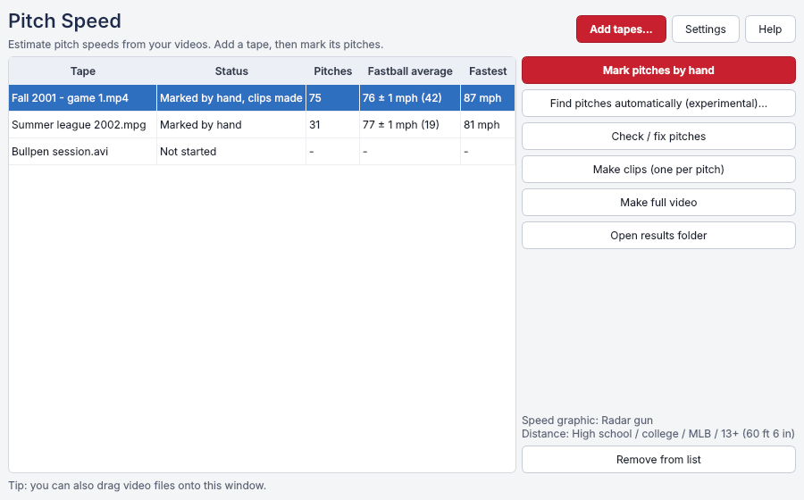
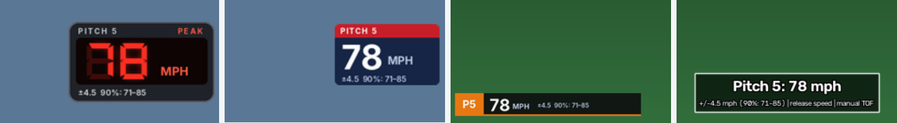

# Pitch Speed

Estimate the speed of baseball (or softball) pitches from video, including
old camcorder tapes digitized to a file. Free, for Windows.



**How it works:** you step through the video and mark two moments per pitch,
when the ball leaves the hand and when it reaches the glove (or the bat).
From the time between them and the pitching distance, Pitch Speed works out
the **release speed** (what a radar gun shows), with an honest **± range**.
It works with any camera angle, even when the camera moves or zooms.

You get:
- a table of every pitch (`results.csv`, opens in Excel) and a **fastball
  average** per tape;
- **one video clip per pitch** with the speed on screen, in one of four
  styles (radar gun, TV broadcast box, sports bar, plain text), plus an
  untouched copy of each pitch for your own editing;
- optionally the whole tape with the speeds shown.



**How accurate?** It depends mostly on the video's frame rate:
- On ordinary 30-frames-per-second video, a single pitch is good to about
  **±5 mph**, because the release and the catch each fall somewhere inside
  a 1/30 s frame. Averages over many pitches are much tighter (±1–2 mph for
  20 or more).
- Video that keeps both half-pictures of each tape frame (60 per second)
  halves that.
- Checked against a Pocket Radar on one YouTube video: 14 of 16 hand-marked
  pitches were inside the tool's range. See [Accuracy](#accuracy).

There is also an **experimental automatic mode** that finds the pitches by
itself on a fixed camera. It has only been tested on computer-made videos so
far; check its results.

**Download:** [latest Windows installer](https://github.com/Skewtoob/Pitch-Speed-Estimator/releases/tag/latest-windows)
(**PitchSpeed-Setup.exe**). It is not code-signed, so Windows will warn the first time:
click **More info**, then **Run anyway**.

Problems, questions or results you'd like to share:
[open an issue](https://github.com/Skewtoob/Pitch-Speed-Estimator/issues).

---

## Install (Windows)

### Easy way: the installer (no Python needed)

1. On the project's GitHub page, open **Releases** (right-hand side) →
   **Pitch Speed for Windows (latest build)** and download
   **PitchSpeed-Setup.exe**.
2. Run it. It installs for your user account only (no administrator rights),
   with a Start-menu entry, an optional desktop icon and an uninstaller
   (Windows Settings → Apps). Windows may say "Windows protected your PC"
   because the program is not signed: click **More info** → **Run anyway**.
3. Open **Pitch Speed**. To update, run a newer PitchSpeed-Setup.exe; your
   results (next to your videos) are not touched.

Prefer no installer? Download **PitchSpeed-Windows.zip** instead, unzip it
anywhere and open `PitchSpeed.exe` in the `PitchSpeed` folder.

### The Pitch Speed window

- **Add tapes...** (or drag video files onto the window) puts tapes in the
  list. Each shows its status, the number of pitches, the **fastball
  average** (with its ± and how many pitches it is based on) and the fastest
  speed. The list is remembered. The fastball average uses the fast group
  when a tape's speeds split into slow and fast pitches (curveballs and
  changeups are left out), else all pitches; averaging many pitches is far
  more precise than any single one.
- **Settings**: pitching distance (league), **how you mark the catch** (when
  the ball reaches the glove, or at the catcher's squeeze: the squeeze comes
  about 25 ms later, so the tool corrects for it; this correction was
  measured on one radar video only), the size of the marking window,
  sound on/off, and the **speed graphic** in the videos it makes:
  - **Radar gun**: red LED digits, like a radar-gun display;
  - **TV broadcast box**: a TV-style pitch box;
  - **Sports bar**: a strip along the bottom (kept off the bottom-right corner,
    where camcorders put the date);
  - **Plain text**.
- **Mark pitches by hand** opens the marking window (keys below); when you
  close it with **Q**, the clips are made. **Find pitches automatically
  (experimental)...** has only been tested on computer-made videos so far:
  check the pitches it finds. It asks where the camera was, then opens the click-the-points window, finds the
  pitches, and opens the review window.
- **Check / fix pitches**, **Make clips**, **Make full video** and **Open
  results folder** work on the tape selected in the list. A progress window
  shows each step, with the time left where it is known.

### From source (with Python)

1. Install **Python 3.10 or newer (64-bit)** from
   [python.org](https://www.python.org/downloads/). The default options are fine.
2. Download this project (green **Code** button → **Download ZIP**) and unzip
   it to a normal folder such as `Documents` or `C:\pitchspeed`. **Not**
   `C:\Program Files`: Windows only lets a program change that folder when it
   was started with *Run as administrator*. If you did unzip it there, the
   installer offers to copy itself to `C:\Users\<you>\pitchspeed`. You can
   also right-click `install.bat` and choose *Run as administrator*.
3. Double-click **`windows\install.bat`**. It creates a private Python
   environment in `.venv` and installs everything (a few minutes the first time).

**Updating to a new version:** download and unzip the new ZIP the same way,
then double-click `windows\install.bat` again. A new version can need extra
packages (for example Pillow, for the radar-gun graphics), and the installer
adds them.

To analyze a video, **drag the video file onto `windows\pitchspeed.bat`**.
A console window walks you through the steps below.

Command-line use (from the project folder):

```
.venv\Scripts\pitchspeed run "D:\Tapes\game1.avi"
```

macOS/Linux: `python3 -m venv .venv && .venv/bin/pip install -e .`, then
`.venv/bin/pitchspeed run video.avi`.

## How it works, step by step

The first time you run a video, the tool asks how to find the pitches:

1. **Automatically** (steps 1-4 below): you click the pitching rubber and home
   plate once, and the tool finds every pitch and tracks the ball. Best for a
   camera on a tripod.
2. **By hand** ([Marking pitches by hand](#marking-pitches-by-hand-any-camera-angle)):
   you press a key at each release and catch. Works with any camera angle,
   even if the camera moves or zooms, and on long tapes.

`pitchspeed run VIDEO` does the four automatic steps. You can also run each one on its own.

Running it again on the same video (e.g. dragging it onto `pitchspeed.bat`
a second time) asks whether to **keep the saved results** and go straight
to the review (the default: just press Enter) or to **analyze the video
again**. Your review work is never thrown away: before results with review
edits are replaced, they are copied to `results.backup-<date-time>.json`,
and your manual, edited and rejected pitches are carried over into the new
results whenever the new analysis still lines up with the old one.

### 1. Calibrate (`pitchspeed calibrate VIDEO`)

The console asks where the camera was (**side** or **behind** the plate),
the pitching distance (league preset or your own number), and for side
views which hand the pitcher throws with. Then a window opens on the video.
The bar at the top always says what to click next.

| Camera view | Click (required) | Optional extra clicks |
|---|---|---|
| **Side**: the ball crosses the screen | middle of the **pitching rubber**; middle of **home plate** | ball at **release**; **glove** at the catch; top and bottom of something **vertical** (a pole) |
| **Behind** the plate: looking out at the pitcher | the **ball in the pitcher's hand at release**; the **catcher's glove** where the ball is caught | the two ends of the rubber; the two front corners of the plate (give the tool the ball size) |

Tips:
- Use arrow keys (or A/D) to step one field at a time, W/S for one second,
  `[` `]` for ten seconds. Find a frame where the pitcher is releasing the ball
  before clicking **release**, and one where the ball is in the glove for **catch**.
- **Z** shows an 8× magnifier; I/J/K/L nudge the selected point by ¼ pixel.
- **M**, then drag: mask out a burned-in date/time stamp.
- If the camera was moved or zoomed partway through the tape, go to that
  point and press **G** to start a new calibration segment. Click the
  points again there.
- **Enter** checks your clicks and shows warnings; press **Enter** again to save.
  **H** shows all keys. If you close the window with its **X** after
  clicking, the console asks whether to save the points.

The calibration is saved in `<video name>_pitchspeed\calibration.json`
next to the video. You only do this once per video, or per camera setup.
If the saved calibration looks like it belongs to another file (different
name, length or picture size), the tool says so before using it.

### 2. Analyze (`pitchspeed analyze VIDEO`)

Finds the pitches and prints a table like this:

```
#  time          frames   speed  +/-  90% range  avg  method    label  flags
1  00:00:02.504  75-89       86  1.5  84-88       82  side fit  good   -
2  00:00:08.961  268-288     60    1  58-61       56  side fit  good   -
3  00:00:14.992  449-466     75    1  73-76       71  side fit  good   -
```

- **speed**: release speed in mph (out of the hand, what a radar gun reads).
- **+/-**: one standard deviation. **90% range**: the true speed should be
  inside it 9 times out of 10, if the assumptions listed above the table hold.
- **avg**: average speed from release to catch. The ball loses about 8–10% of its
  speed on the way, so this is lower than the release speed.
- **label**: `good` (±2.5% or better), `fair` (±5%), `poor` (±10%, shown as
  `~78?`), or `n/a` when it cannot be measured honestly (the reason is listed
  under *Notes*).
- **time** and **frames** tell you where the pitch is in the video. The
  annotated video shows the same pitch numbers.

Anything moving that wasn't accepted as a pitch (throws back to the pitcher,
birds, …) is counted, and suspicious moments are listed as *possible missed
pitches* for you to check in review. Nothing is silently dropped.

### 3. Review (`pitchspeed review VIDEO`)

Steps through every pitch and every "possible missed pitch". The main keys:

| Key | Action |
|---|---|
| ←/→ (A/D) | back / forward one field (1/60 s) |
| ↑/↓ (W/S) | back / forward 10 fields |
| `[` / `]` | previous / next pitch |
| **R** | release = this field (the **first** field where the ball is out of the hand) |
| **C** | catch = this field (the **first** field where the ball is in the glove) |
| **B** | bat contact = this field, for a ball the batter **hit** (the **first** field where the ball touches or has just left the bat); use it instead of C |
| Tab, `,` `.` | select the R or C marker and nudge it by one field |
| **Y** / Enter | accept the pitch |
| **X** / Del | reject it (kept in the file as "rejected") |
| **N** | add a pitch the tool missed: press N at the release, then C at the catch (or B if it was hit) |
| **E** | re-run the ball tracker between R and C |
| **G** | side by side: the 8 fields around this one, magnified (see [Picking the exact field](#picking-the-exact-field)) |
| Space | play/pause, loops around the pitch; `+`/`-` change speed |
| U | undo |
| H | all keys |
| Q / Esc | save and quit |

Every edit re-computes that pitch's speed immediately and saves the results.
Windows you have dealt with (a pitch added there, or X = no pitch) are skipped
by `[` / `]`; **O** shows everything again. When the message says *everything
is checked*, press **Q** to save and quit.

**Balls the batter hit.** The tool usually notices a hit by itself and ends
the flight at the bat (the table shows the flag `contact_end`). If it got a hit
ball wrong, mark the release with **R** and the contact with **B**, not C.
C means "in the glove", which is about 3 ft farther, so a C mark would make a
hit ball read about 6 % too fast. In a side view the speed comes mostly from
the flight before the swing, so a hit barely matters there.

**Running again.** Dragging the same video onto `pitchspeed.bat` again asks
whether to keep the saved results and go straight to review (the default)
or analyze again. Analyzing again never silently throws away your review
work: a backup (`results.backup-<date-time>.json`) is written first, and your
hand-marked, edited and rejected pitches are carried over (as long as the
video and the calibration clicks are unchanged; otherwise the console says
so and the backup keeps them).

### 4. Annotated video (`pitchspeed render VIDEO`)

Writes `<video name>_pitchspeed\annotated.mp4`, standard H.264 video with
the original sound. It should play in the Windows Films & TV app and in VLC
(not yet tested on a Windows PC). `--mode highlights` writes only the pitches.

- **Ball path.** While a pitch is in flight, its path grows behind the ball:
  a glowing line with a white dot at each place the tool saw the ball (one
  per video field, or frame; dots that would overlap are left out). Where the ball was
  hidden for a few fields, the line is thin and dashed: that part is
  estimated, not seen. Nothing is drawn before the ball was first seen or
  after it was last seen. After the catch the whole path stays on screen
  with the speed.
- **Radar gun.** At the catch a radar-gun display shows the release speed
  (the "out of the hand" speed a radar gun shows) in red LED digits, with the
  margin of error underneath: `±2  90%: 78–84` means the estimate is usually
  within 2 mph of the true speed (about 2 times in 3), and there is a 90%
  chance the true speed is between 78 and 84. A rough estimate shows
  an amber `~` in front of the number, `EST` at the top and `rough` at the
  end; a pitch that could not be measured shows `--` and "not measurable".
  It sits in the top-right corner, or top-left if the ball's path runs
  through the top-right corner. It stays for 3 seconds, or until the next
  pitch is thrown.
- **Running list.** The pitches so far (`P1 76  P2 ~65?  P3 n/a`) stay in
  the top-right corner.

`pitchspeed render VIDEO --style classic` gives the earlier plain-text look.

`pitchspeed render VIDEO --mode clips` writes **one short video per pitch**
instead (see [One clip per pitch](#one-clip-per-pitch)).

## Marking pitches by hand (any camera angle)

Choose **2** when the tool asks how to find the pitches, or run
`pitchspeed mark VIDEO`. There is nothing to click on the picture: the
speed comes from the time between your two marks and the pitching
distance, so the camera angle, zoom and camera movement don't matter.

1. The console asks for the pitching distance (league) once.
2. A window opens on the start of the video. Find the pitches:
   - **Space** plays and pauses; **+** / **-** change the speed (up to 8x);
   - **J** / **L** jump 1 second back / forward; **W** / **S** 10 fields;
     **A** / **D** (or the arrow keys) one field;
   - **click the bar at the bottom** to jump anywhere in the tape: it covers
     the whole video and shows each pitch you've marked.
3. At each pitch: pause (**Space**), step with **A**/**D** to the **first
   field with the ball out of the hand** and press **N**, then step to the
   **first field with the ball in the glove** and press **C** (or **B** at the
   bat if the batter hit it). The speed appears right away. Space plays on to
   the next pitch. (Pressing N, C or B while the video plays just pauses it:
   a mark has to be on the exact field, or the speed would be off.)
   **G** shows the fields side by side to pick the exact one: see below.
4. **PgUp** / **PgDn** go back through the pitches you've marked. Near a
   pitch, R/C/B move its marks, X rejects it and U undoes. Keys never change
   a pitch you're not near.
   - **If motion jumps back and forth** when you step field by field (a
     player seems to shake forward-back-forward), the tape's field order was
     detected wrong: press **K** to switch it. The window says so at the
     start when the detection was unsure. Marks you already made stay on the
     same pictures.
5. **Q** saves and quits (everything is also saved as you go). Then the tool
   writes [one clip per pitch](#one-clip-per-pitch) (or the full or
   highlights video if you choose).

Running the same video again continues where you left off.

### Picking the exact field

On old tape one field is 1/60 s, and **one field off at either end changes
the speed by about 2-3 mph** (one frame, on video without separate fields,
by about 4-6 mph). The ball and the arm are small and blurry, so it is easy to
be a field or two early or late. **G** helps:

1. Pause near the release, **point the mouse at the pitcher's hand** and
   press **G**. The picture area now shows the **8 fields around this one
   side by side**, each magnified around the spot you pointed at. The one
   with the **yellow border** is the field you're on.
2. Compare them: the arm comes forward, the ball leaves the hand. Press
   **A**/**D** or **click a picture** to move the yellow border to the
   **first field with the ball out of the hand**, then press **N**.
3. Step on to the glove (**D**, or **S** for 10 fields; the pictures
   follow). To magnify the glove: press **G**, point the mouse at the glove,
   press **G** again. Put the yellow border on the **first field with the
   ball in the glove** and press **C** (or **B** at the bat).

**Wrong spot magnified?** Press **-** until you see the whole pictures
(small), then **right-click** the hand or the glove on any of them: that
spot is magnified 3x. **+** / **-** zoom in and out (whole pictures, 1.5x
to 8x). **G** or **Esc** goes back to the normal view. Marks you've made
show on the pictures (R, C, B). G works in `pitchspeed review` too.

**Careful with the release.** Right after it leaves the hand the ball is
often in front of the pitcher's body and can't be seen, so the first
picture where you can *see* it clear of the hand may be a frame or two
after the real release. Marking there makes the speed read too high. Use
the arm as well: the ball leaves when the hand is out in front of the head,
just before the arm whips down across the body.

**Careful with the catch.** The catcher squeezes the glove a little after
the ball gets there. Mark the first picture where the ball **reaches** the
glove (it disappears into it, or the glove gets knocked back), not the
squeeze. Each picture late makes the speed read about 2-5 mph too low. If
you prefer the squeeze, choose it under Settings (or `--catch-cue squeeze`)
and the tool corrects for it.

**How accurate is it?** In a simulation where a quarter of the marks were
one field off, hand-marked speeds were typically within about 2-3 mph
(3-4 %), and the shown ± and 90% range matched what really happened. That
is less precise than the automatic method on a good side view (about 1 %),
but it works on any footage. Hand-marked pitches get the radar-gun display
but no ball path (nothing tracked the ball). These numbers come from
computer-made videos, not real tapes yet.

**Several tapes:** select several video files and drag them onto
`pitchspeed.bat` together; they are done one after the other.

## One clip per pitch

`pitchspeed render VIDEO --mode clips` (also offered at the end of
`run` and `mark`) writes into `<video name>_pitchspeed\clips\`:

- `P03_81mph.mp4`: the pitch with the radar-gun display (and the ball path
  if it was tracked), from 2 s before the release to 3 s after the catch,
  with sound. When pitches come quickly, a clip is cut halfway to the
  previous or next pitch, so it never shows another pitch's catch or
  wind-up, and it only ever shows its own pitch's speed. A rough estimate is named `P02_66mph_rough.mp4`, a pitch that
  could not be measured `P05_no_speed.mp4`.
- `originals\P03.avi` (or `.mpg`, ...): the same moment of your original
  video, copied **without re-encoding**: same quality and same fields, ready
  for your own editing. It starts a little earlier than the clip (usually
  about a second, for some files several seconds), because a copy without
  re-encoding can only start at certain frames - so it can begin with a bit
  of the previous pitch; trim that in your editor. Each copy is checked; if one
  cannot cover the whole pitch, the console says so instead of keeping it.

Making the clips again (after review edits) replaces the clips it made
before, including ones whose name changed; other files you put in the
folder are left alone. If a new clip cannot be made, the old one is kept; a
clip that is open in a video player is removed the next time.
`--no-originals` makes no new untouched copies (the existing ones are kept).

## Output files

All in `<video name>_pitchspeed\` next to the video:

| File | What |
|---|---|
| `results.csv` | one row per pitch (Excel-friendly) |
| `results.json` | everything, including ball tracks and the uncertainty breakdown |
| `annotated.mp4` | the video with speeds overlaid |
| `clips\` | one video per pitch, and `clips\originals\` untouched copies (`--mode clips`) |
| `calibration.json` | your clicks and settings (for marking by hand: only the settings) |
| `results.backup-<date-time>.json` | your earlier results, kept whenever results with review edits were replaced |

Two files with the same name but a different extension (`game1.avi` and an
exported `game1.mpg`) get separate folders (`game1_pitchspeed` and
`game1_mpg_pitchspeed`), so they never share clicks or overwrite each
other's results.

## Accuracy

The ± range on each pitch is the tool's own estimate of its uncertainty. On
computer-generated test videos with known speeds, which were not used during
development, it did this:

| | Side view | Behind the plate |
|---|---|---|
| Pitches found | 45 of 45 | 44 of 45 |
| Typical error (RMS) | 0.7 mph (1 %) | 3.3 mph (6 %) |
| Pitches given a speed | all | 28 of 44 (the rest: "n/a" with a reason) |
| True speed inside the 90 % range | 45 of 45 | 27 of 28 |

Details and caveats are in [docs/ACCURACY.md](docs/ACCURACY.md). In short:

- **Side view** is the most accurate. Speed is measured from the ball's
  motion across the frame, with the rubber-to-plate distance as the ruler.
- **Behind the plate** can only time the flight from release to catch.
  - It depends on where the pitcher lets go (the **extension**, assumed
    about 5.5 ft in front of the rubber at high-school distance, less for
    youth fields) and on the catch instant, which the catcher often hides.
  - Expect "poor" (±5–10 %) or "n/a". Entering the pitcher's real
    extension (`--extension`) and marking release and catch by hand in
    review help.
- **Video quality**:
  - The ball is often only 1–3 pixels across, and heavy re-compression
    (e.g. a YouTube download) can erase it. Use the **original capture
    file** (DV-AVI or MPEG-2 from the capture device) whenever possible.
  - Deinterlaced or 30p files lose the half-frame timing. The tool detects
    this and widens the ±.
- **Automatic mode** has only been tested on computer-made videos.

### On real footage (marking by hand)

The numbers above are from computer-made videos. On real video so far:

- **Radar check:** a high-school pitcher filmed with a Pocket Radar reading on
  screen (30 frames per second, from behind the plate), 16 pitches marked by
  hand: 14 of 16 inside the tool's 90 % range. Fastballs read about 4 mph
  low on average. That came mostly from marking the catch at the catcher's
  squeeze, which comes a little after the ball arrives; the **"I mark the
  catch"** setting corrects for it.
- **A 2001 Hi8 tape** captured to 30 frames per second, 75 pitches by one
  pitcher: the fastball average came out where the pitcher remembered.
- **Many YouTube "radar" highlight videos can't be used to check speeds**:
  they repeat frames (slow-motion edits, frame-rate conversion), so counting
  frames no longer measures time. Before trusting one, step through a pitch
  and make sure the picture changes on every frame.
- What makes the biggest difference: marking consistently (the same cue every
  pitch), the side-by-side view (**G**) for picking the exact frame, and
  averaging many pitches.

## Settings you may want

| Option | Use |
|---|---|
| `--level hs / 54 / 50 / ll / 40 / sb43 / sb40 / sb35` or `--distance FT` | pitching distance (rubber to the back point of the plate). Check your league. |
| `--sport baseball/softball` | with `--distance`: which ball (a `--level` already implies it) |
| `--extension FT` | the pitcher's release point in front of the rubber, if you know it |
| `--throws R/L` | the pitcher's throwing hand (improves side views slightly) |
| `--field-order tff/bff/progressive` | override interlace detection (rarely needed) |
| `--start S --end S` | analyze only part of the video (seconds) |
| `--ui-scale 1.5` | bigger click/review windows on high-resolution screens |
| `--debug` | write diagnostic images to `<out>\debug\` |
| `pitchspeed probe VIDEO` | show format, interlacing and field order |

Settings given to `run` or `analyze` (`--level`, `--distance`, `--sport`,
`--extension`, `--throws`, `--altitude`, `--temp`) are saved in
`calibration.json` and the change is printed; if you keep the saved
results, their speeds are recomputed with the new settings (your review
edits stay). Changing the camera view needs new clicks
(`pitchspeed calibrate VIDEO --view ...`).

## Troubleshooting

- **"cannot open a window"**: the window library is missing. Reinstall with
  `.venv\Scripts\pip install --force-reinstall opencv-python`. Don't use
  `opencv-python-headless`.
- **Keys don't work in the windows**: run `pitchspeed keys` and send the
  printed codes. Every arrow key also has a letter twin (A/D/W/S).
- **No pitches found**: check the calibration clicks, and try `--debug`.
  Mark pitches by hand in review (**N**, then **C**).
- **Speeds look systematically off**: check the pitching distance, and on
  side views make sure you clicked the *middle* of the rubber and of the plate.
- **"results.csv is open in another program"**: Excel locks the file. Your
  results are safe in `results.json`; close Excel and press Enter to write
  the CSV again (or quit `pitchspeed review` later, which rewrites it).
- **annotated.mp4 is open in a video player**: close the player and press
  Enter, or let the tool write `annotated-1.mp4` instead.

## License

Pitch Speed is free software under the MIT license (see [LICENSE](LICENSE)).

## Credits

The video graphics use the [Inter](https://github.com/rsms/inter) font
(Copyright (c) 2016 The Inter Project Authors), included unmodified under the
SIL Open Font License 1.1: see `src/pitchspeed/render/fonts/OFL.txt`.

## For developers

- Design and the reasoning behind the methods: [docs/DESIGN.md](docs/DESIGN.md)
  and [docs/design-notes/](docs/design-notes/) (research notes with sources).
- Tests: `pip install -e .[dev]`, then `pytest -m "not slow and not gui"`.
- Synthetic test videos with ground truth: `pitchspeed synth generate --out clip.mpg`
  and `pitchspeed synth suite --n 24 --out-dir suite/`. Score results with
  `pitchspeed synth evaluate suite/`.
